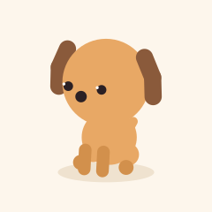

# zpup

A modern, AI-friendly pseudo-3D engine for the web, inspired by [Zdog](https://zzz.dog/).

Pronounced "zee-pup".



The pup above is a single SVG file with no JavaScript. It was rendered by `renderSpinSvg` from [a short scene description](examples/pup.ts) and turns in current browsers, including inside a GitHub README.

**[Try it in the playground](https://rxolve.github.io/zpup/)**: edit a scene as JSON, drag the picture to turn it, and export a still or turning SVG.

## Status

Early work in progress. The core (scene tree, transforms, orthographic projection, depth sorting) and the SVG string renderer work and are tested, but the API may still change. The npm package is `@zpup/core`. Its `0.0.0` release only reserves the name; nothing usable is published yet.

Not built yet: a canvas renderer, general animation, and framework bindings. The one animation available is a constant turn about one axis (see [Turning in place](#turning-in-place)).

## Install

Until the first release, install from GitHub (this needs a build step, so clone and build):

```bash
git clone https://github.com/rxolve/zpup.git
cd zpup
pnpm install
pnpm build
```

Once published it will be `npm install @zpup/core`. zpup is ESM-only and has no runtime dependencies.

## Usage

A scene is a plain object tree. `renderSvg` turns it into an SVG string, with no DOM, so it works on a server and the first paint needs no JavaScript. Here is the pup from the top as a still picture, `renderSvg(pup)`:



A smaller scene:

```ts
import { dot, ellipse, renderSvg } from '@zpup/core';

const svg = renderSvg({
  width: 120,
  height: 120,
  rotate: { x: -20, y: 30 },
  children: [
    dot({ stroke: 40, color: '#e62' }), // a thick dot is a sphere
    ellipse({ diameter: 70, stroke: 5, color: '#636', rotate: { x: 90 } }), // a ring around it
  ],
});
```

The helpers only add a `type` field, so the same scene can be written, stored and sent as JSON:

```json
{
  "width": 120,
  "height": 120,
  "rotate": { "x": -20, "y": 30 },
  "children": [
    { "type": "path", "path": [{}], "stroke": 40, "color": "#e62" },
    { "type": "ellipse", "diameter": 70, "stroke": 5, "color": "#636", "rotate": { "x": 90 } }
  ]
}
```

### The basics

- **Axes:** x right, y down, z toward the viewer. The origin is the center of the image.
- **Angles:** degrees. Positive `rotate.z` turns clockwise on screen.
- **Nodes:** `group`, `path`, `ellipse`, `rect`, `polygon`, and the solids `box`, `cylinder`, `cone` and `hemisphere`. Every node takes `translate`, `rotate`, `scale`, `visible` and `children`; children inherit their parent's transform.
- **Shapes:** `color`, `stroke` (round-capped width; thick strokes give volume) and `fill`.
- **Solids:** always filled. One `color` is enough: each face gets a fixed lighter or darker version of it by the direction it faces in the scene, so a box does not collapse into a flat hexagon. Face options such as `topFace` or `frontFace` set a face's exact color. As in Zdog, cylinders, cones and hemispheres point along z; `rotate: { x: 90 }` stands them up.
- **Errors:** an invalid scene throws a `ZpupValidationError` that lists every problem with its path, what was expected and how to fix it. `checkScene(scene)` returns the same list without throwing. `checkSceneWarnings(scene)` lists things that are valid but probably unintended, such as angles in radians or shapes placed outside the image.

### Solids


[The lighthouse](examples/lighthouse.ts) is made of eleven solids, each with a single color, plus a door and a window drawn as rectangles on the tower:

```ts
import { cone, cylinder } from '@zpup/core';

const up = { x: 90 }; // round solids point along z; this stands them up
cylinder({ diameter: 60, length: 36, rotate: up, color: '#f4f1ea' }); // a band of the tower
cone({ diameter: 44, length: 18, rotate: up, color: '#d8463c' }); // the hut's roof
```

Solids are depth-sorted like everything else, against each other and against flat shapes. Rest one solid on a flat face of another; solids that cut into each other cannot be drawn correctly.

### Turning in place

`renderSpinSvg` returns an SVG that turns the scene one full rotation, forever, using SMIL animation. It needs no JavaScript, so it also plays inside an `` tag and in a GitHub README.

```ts
import { renderSpinSvg } from '@zpup/core';

const svg = renderSpinSvg(scene, {
  axis: 'y', // which angle of scene.rotate turns: 'x', 'y' (default, a turntable) or 'z'
  duration: 8, // seconds per turn
  keyframes: 36, // exact angles per turn; the browser interpolates in between
  direction: 'positive', // or 'negative'
  precision: 1, // decimals kept in coordinates
});
```

Every option is optional, and bad values throw a `ZpupValidationError` like an invalid scene does. Renderers without SMIL show the first frame, which is the same picture `renderSvg` draws.

Limits:

- Only a constant-speed turn about one axis. Nothing else moves, and there is no interaction or pausing.
- It does not respect `prefers-reduced-motion`; SMIL cannot query it. A page that cares can show the still picture instead with a `<picture>` element and a `(prefers-reduced-motion: reduce)` media query.
- Outlines are drawn one segment at a time, so a translucent color shows darker spots where the segments meet.
- File size grows quickly with the number of pieces: every piece is listed once per change of paint order, and those changes grow with the number of overlapping pairs. The pup (19 pieces) is 54 KB, 11 KB gzipped; the lighthouse (34 pieces) is 132 KB, 24 KB gzipped. Lower `keyframes` and `precision` make it smaller.

See [docs/decisions.md](docs/decisions.md#turning-animation) for how it works.

There is no lighting and no perspective, by design. See [docs/decisions.md](docs/decisions.md) for the reasoning behind these and other choices, and [llms.txt](llms.txt) for a compact reference written for AI coding tools.

## Goals

- Round, flat, designer-friendly pseudo-3D illustrations, in the spirit of Zdog
- TypeScript and ESM from the start
- A declarative API that is easy for both people and AI coding tools to write correctly
- SVG output that can be rendered on the server
- Depth sorting that holds up when shapes overlap

## Development

Requires Node.js 22.18 or later (the example script runs TypeScript directly) and [pnpm](https://pnpm.io/).

```bash
pnpm install
pnpm test        # unit and snapshot tests
pnpm typecheck
pnpm lint
pnpm build       # writes dist/
pnpm example     # writes the pup and lighthouse pictures in examples/
pnpm playground:build  # builds the playground into playground/dist/, servable as static files
```

## Credits

zpup is inspired by [Zdog](https://github.com/metafizzy/zdog) by David DeSandro. It is a new implementation that shares no code with Zdog. It is an independent project and is not affiliated with Zdog or Metafizzy.

## License

MIT
